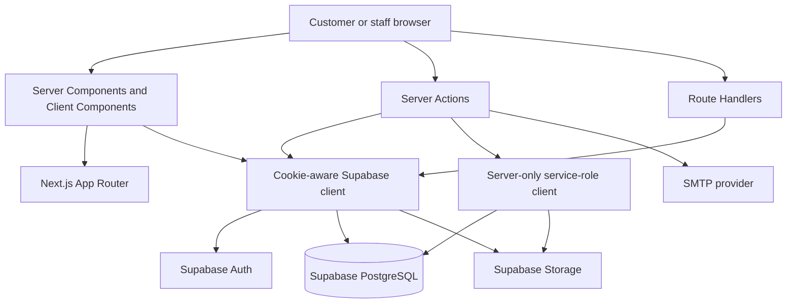

# Classic Computers LLC

Classic Computers LLC is a Malawi-based electronics retailer and technology
services business in Blantyre. This repository contains its full-stack retail
and business operations platform: customers can discover products, submit
orders and service requests, and manage an account, while authorized staff use
the administration area to manage the related business records.

- **Website:** [classiccomputers.mw](https://classiccomputers.mw/)
- **Repository:** [MkandawireChico/classic-computers](https://github.com/MkandawireChico/classic-computers)

## Contents

- [Project overview](#project-overview)
- [Features and implementation status](#features-and-implementation-status)
- [Technology stack](#technology-stack)
- [Architecture](#architecture)
- [Project structure](#project-structure)
- [Prerequisites](#prerequisites)
- [Local development](#local-development)
- [Environment variables](#environment-variables)
- [Database, security and storage](#database-security-and-storage)
- [Orders and payments](#orders-and-payments)
- [Email and notifications](#email-and-notifications)
- [Administration and customer accounts](#administration-and-customer-accounts)
- [Quality checks](#quality-checks)
- [Deployment](#deployment)
- [Troubleshooting](#troubleshooting)
- [Contributing](#contributing)
- [Business information and license](#business-information-and-license)

## Project overview

The application combines a public storefront with account, service-request and
staff administration workflows. Product, inventory, order, customer and service
data are stored in Supabase. The platform supports product discovery and manual
payment orders as well as requests for rentals, repairs and corporate ICT
supply.

The application is implemented with Next.js App Router and Supabase. The
repository does not contain production credentials or a checked-in deployment
pipeline. Production database, authentication email and SMTP state must be
verified in the relevant Supabase and hosting environments.

## Features and implementation status

The following describes behavior implemented in the application and database
migrations in this repository. A route or workflow still depends on the
connected Supabase project having the corresponding migrations and settings.

### Storefront and product discovery

- Public product catalogue with product categories and brands.
- Product search, category and brand filters, price and availability filters,
  sorting and pagination.
- Product detail pages with images, specifications, variants, stock status and
  customer reviews where available.
- Cart for signed-in customers and guests.
- Product comparison and signed-in customer wishlists.
- Product enquiries and direct phone or WhatsApp contact links.

Only published products are exposed to public product queries. Database
policies enforce this in addition to the application query filters.

### Customer accounts

Customers can register, confirm their email, sign in, reset or update a
password, and manage their profile and saved addresses. The account area
provides:

- Order history, order details, payment and fulfilment status, and order-status
  history.
- Rental and repair request history and status.
- Enquiries, notifications, saved products, referrals and student-verification
  status.
- Reviews for eligible completed product, rental or repair transactions.

Guest checkout provides a confirmation page protected by a temporary
HTTP-only cookie. Persistent order history is available through a customer
account.

### Business services

- Rental equipment catalogue, rate information where configured, availability
  checks and rental requests. A request is not a confirmed booking; staff
  review availability and follow up.
- Repair request submission and repair tracking using the ticket reference and
  tracking code. Signed-in customers can also view their requests in their
  account.
- General and corporate supply/quotation enquiries.
- Student verification submissions and eligible student offers.

These are request and management workflows; they do not imply automatic
approval, confirmed rental availability, or an automated repair assessment.

### Staff administration

The permission-aware `/admin` area contains modules for:

- Dashboard summaries and recent business activity.
- Products, brands, categories, variants, product media and inventory.
- Orders, customers and customer records.
- Rental requests and repair tickets.
- General and corporate enquiries.
- Student verification and discounts.
- Reviews and moderation.
- Referrals, site settings and site media.
- Staff accounts, roles and permissions.
- Internal email notification outbox and customer-interest analytics.

Admin pages and actions check permissions. The database also enforces
role/permission-based access with Row Level Security (RLS). Analytics requires
the analytics migration and consented events; event cleanup has a database
function but no scheduled job is configured by this repository.

## Technology stack

Versions below are from the checked-in `package.json`; dependency ranges are
resolved by `package-lock.json`.

| Technology                                         | Use                                                                  |
| -------------------------------------------------- | -------------------------------------------------------------------- |
| Next.js `14.2.15`                                  | App Router, server rendering, Route Handlers and Server Actions      |
| React `18.3.1`                                     | UI and interactive client components                                 |
| TypeScript `5.5.2`                                 | Application and database-client types                                |
| Tailwind CSS `3.4.4`                               | Styling                                                              |
| Supabase JS `^2.45.4` and `@supabase/ssr` `^0.5.2` | Database, Auth, Storage and cookie-aware clients                     |
| PostgreSQL                                         | Application database; local Supabase config targets major version 17 |
| Zod `^3.23.8`                                      | Input validation                                                     |
| Nodemailer `^10.3.1`                               | Server-side SMTP delivery for internal request notifications         |
| Supabase CLI `^2.117.0`                            | Local Supabase development and migration commands                    |
| ESLint `^8.57.0` and Prettier `^3.3.2`             | Linting and formatting                                               |

`package.json` declares Node.js `>=22.0.0`. See the [deployment](#deployment)
section for the discrepancy with the supplied cPanel Node.js 20 environment.

## Architecture



Server Components perform most page data reads through `lib/data`. Interactive
forms and controls use Client Components and call Server Actions or Route
Handlers. Server Actions validate input and delegate business operations to
`lib/services`; Zod schemas live under `schemas`.

The normal Supabase server client carries the current user's cookies and remains
subject to RLS. The separate `server-admin.ts` client uses the service-role key
and bypasses RLS; it is server-only and should only be used for operations that
need it after application-level authorization. Permission checks are enforced
in server code as well as by database policies.

The application exposes a health Route Handler at `/api/health`, a consent-aware
customer-interest event Route Handler at `/api/analytics/events`, and Supabase
Auth callback/confirmation routes. It is not a general-purpose public REST API.

## Project structure

```text
app/
  (auth)/                 Sign-in, sign-up and password forms
  (storefront)/           Storefront, checkout, account and service pages
  admin/                  Permission-protected administration pages
  api/                    Health and analytics Route Handlers
  auth/                   Supabase Auth callback and confirmation routes
components/
  admin/                  Staff interface
  navigation/             Shared navigation controls
  product/                Product cards, galleries, grids and controls
  storefront/             Storefront, account and service components
  ui/                     Shared UI primitives
lib/
  auth/                   User, site URL and permission helpers
  data/                   Supabase-backed read operations
  email/                  Internal notification email templates
  payments/               Manual payment provider details
  services/               Server-side business workflows
  supabase/                Browser, server, middleware and admin clients
schemas/                  Zod request schemas
supabase/
  migrations/              Ordered PostgreSQL, RLS and Storage changes
  templates/               Local Supabase Auth email templates
  config.toml              Local Supabase configuration
  seed.sql                 Development-only local seed data
types/
  catalog.ts               Product and storefront domain types
  supabase.ts              Supabase database types
```

Root configuration includes `package.json`, `package-lock.json`,
`tsconfig.json`, `next.config.mjs`, `tailwind.config.ts`,
`postcss.config.mjs`, `.eslintrc.json` and `.prettierrc`. The repository does
not include a `Dockerfile`, CI workflow, cPanel startup file or production
deployment manifest.

## Prerequisites

- Node.js `>=22.0.0`, as required by `package.json`.
- npm and Git.
- A Supabase project for shared development, or Docker Desktop and the
  Supabase CLI for the local Supabase stack.

## Local development

Clone the repository and install the locked dependency tree:

```bash
git clone https://github.com/MkandawireChico/classic-computers.git
cd classic-computers
npm ci
```

Copy `.env.example` to `.env.local` and supply the values for your development
environment. `.env.local` is ignored by Git.

```bash
# macOS / Linux
cp .env.example .env.local
```

```powershell
# Windows PowerShell
Copy-Item .env.example .env.local
```

For local Supabase development, start Docker, then run:

```bash
npx supabase start
npx supabase db reset
npm run dev
```

Use the local Supabase URL and keys printed by `supabase start` in `.env.local`.
`supabase db reset` recreates the local database by applying the migrations and
configured seed; it deletes local database contents. The seed contains sample
categories and brands plus a draft development product, not production
inventory.

The development server is available at <http://localhost:3000>. Local Auth
emails are captured by Supabase's local mail testing service; they are not sent
to real customer addresses.

When using a hosted Supabase development project from localhost, set
`NEXT_PUBLIC_SITE_URL=http://localhost:3000` in `.env.local` and add
`http://localhost:3000/**` to the Supabase project's Auth redirect URL allow
list. Development builds now force auth callback URLs to localhost unless an
explicit localhost or 127.0.0.1 origin is configured. Production builds keep
using the configured production origin.

For a hosted Supabase development project, use its project URL and anon key.
Apply migrations only to a database you are authorized to change.

## Environment variables

The following variables are referenced by application code or the checked-in
Supabase configuration. Set public variables before building; keep secrets in
server-side environment configuration only.

| Variable                        | Required?                            | Runtime / visibility              | Purpose                                                                                                                                              |
| ------------------------------- | ------------------------------------ | --------------------------------- | ---------------------------------------------------------------------------------------------------------------------------------------------------- |
| `NEXT_PUBLIC_SUPABASE_URL`      | Yes                                  | Public; build and runtime         | Supabase project API URL used by browser, server and middleware clients.                                                                             |
| `NEXT_PUBLIC_SUPABASE_ANON_KEY` | Yes                                  | Public; build and runtime         | Supabase anon/publishable client key. Access remains constrained by RLS.                                                                             |
| `NEXT_PUBLIC_SITE_URL`          | Recommended; optional in development | Public; build and runtime         | Canonical site origin, metadata, sitemap and auth redirect URL. Defaults to `http://localhost:3000`.                                                 |
| `SUPABASE_SERVICE_ROLE_KEY`     | Conditional                          | Server-only runtime secret        | Privileged server operations, including guest checkout and internal notification outbox operations. It bypasses RLS; never expose it to the browser. |
| `SMTP_HOST`                     | Required for internal email delivery | Server-only runtime secret/config | SMTP server hostname.                                                                                                                                |
| `SMTP_PORT`                     | Optional; defaults to `587`          | Server-only runtime config        | SMTP port. Port `465` uses implicit TLS; other configured ports require STARTTLS.                                                                    |
| `SMTP_USER`                     | Required for internal email delivery | Server-only runtime secret/config | SMTP account username.                                                                                                                               |
| `SMTP_PASSWORD`                 | Required for internal email delivery | Server-only runtime secret        | SMTP account password or provider-issued credential.                                                                                                 |
| `SMTP_FROM_EMAIL`               | Optional; default is fixed           | Server-only runtime config        | If set, must be `notifications@classiccomputers.mw`.                                                                                                 |
| `ADMIN_NOTIFICATION_EMAIL`      | Optional; default is fixed           | Server-only runtime config        | If set, must be `sales@classiccomputers.mw`.                                                                                                         |
| `OPENAI_API_KEY`                | Optional                             | Supabase CLI / local Studio only  | Supabase Studio AI configuration in `supabase/config.toml`; not used by the Next.js application.                                                     |

The public Supabase URL and anon key are required for normal application
operation. The service-role key is not a browser key and is not required for
every page, but privileged workflows such as guest checkout require it.
Internal notification records can be saved without SMTP delivery; configure
SMTP to deliver and retry those messages.

Example variable names and placeholder values are available in
[`.env.example`](./.env.example). The checked-in example contains no working
credentials. The commented `PAYMENT_PROVIDER_API_KEY` and
`WHATSAPP_BUSINESS_API_TOKEN` lines are placeholders only; the application does
not currently read them. `NODE_ENV` is supplied by the Next.js runtime, not
configured as an application secret.

Never copy a production service-role key, SMTP password, or other secret into
README examples, source code, client-side variables or version control.

## Database, security and storage

### Supabase setup and migrations

Database schema changes are maintained as ordered SQL files in
[`supabase/migrations`](./supabase/migrations). `supabase/config.toml` enables
migrations and configures `supabase/seed.sql` for local database resets.
Database objects cover customers and addresses, roles and permissions,
products, variants and specifications, inventory, carts, orders, discounts,
reviews, student verification, referrals, rentals, repairs, enquiries,
notifications, site settings, media, audit logs and email outbox records.

For a local database, `npx supabase db reset` applies migrations and seed data.
For a linked remote project, review the SQL and deployment plan, take an
appropriate backup, and use the Supabase CLI's migration workflow. For example:

```bash
npx supabase link --project-ref <project-ref>
npx supabase db push
```

Confirm the target project and migration status before running remote commands.
Do not use a local reset against a production database. Production schema
changes require review, a recovery plan and a verified backup.

The local Supabase configuration targets PostgreSQL major version 17. Confirm
the hosted database version and migration history before applying changes.
The deployment state of any hosted database cannot be determined from this
repository.

### Authentication, authorization and RLS

Supabase Auth provides email/password registration, confirmation, sign-in and
password recovery. Server and middleware clients use the user's session from
cookies. Roles, permissions and helper functions such as `has_permission`
support staff access. Server Actions check permissions for privileged
operations; RLS policies are the database enforcement layer for user and staff
data. The admin navigation is not itself a security boundary.

The service-role client bypasses RLS. It is marked server-only and should be
limited to operations that need privileged access, after authorization and
ownership checks.

### Storage

Migrations define these Supabase Storage buckets:

| Bucket              | Access                                                                                                                                                                                          |
| ------------------- | ----------------------------------------------------------------------------------------------------------------------------------------------------------------------------------------------- |
| `product-images`    | Public read; writes require the product-management permission.                                                                                                                                  |
| `site-media`        | Public read; writes require the settings-management permission.                                                                                                                                 |
| `repair-documents`  | Private; staff reads and writes require repair permissions.                                                                                                                                     |
| `student-documents` | Private; customer uploads are restricted to the customer's own storage path. Staff reads require student-verification permission; customer access is brokered through an authorized signed URL. |

Do not make private documents public to work around an access error. Check the
bucket policy, caller permission and server-side signed-URL workflow.

### Database functions and triggers

The migrations define PostgreSQL functions and triggers for permission checks,
updated timestamps, audit records, signup/profile/customer setup, inventory
status, order creation and status history, rental status history, referrals,
notifications and the email outbox. The `create_order` function performs the
database-side order workflow. The customer-interest analytics migration
includes `purge_customer_interest_events()`; the repository does not configure
a scheduler to run it.

## Orders and payments

Checkout supports guest and signed-in customers, pickup or delivery, and the
payment methods enabled in Supabase site settings:

- Pay at the shop.
- Bank transfer.
- Mobile money (Airtel Money or TNM Mpamba).
- Cash on delivery.

For bank transfer and mobile money, the checkout displays configured manual
provider/account details and instructions. Customers can enter a transaction
reference. Placing an order or entering a reference does **not** confirm
payment.

There is no integrated payment gateway, card processor, payment-initiation
flow or automatic payment reconciliation in this repository. Staff review
orders and verify manual payments through the administration workflow before
marking them paid. Availability, final totals and order creation are checked
server-side and in the database; an order is not accepted solely on the basis
of client-submitted prices.

## Email and notifications

Customer account notifications are stored in the database and shown in the
account area. Internal request emails use a database outbox for general and
corporate enquiries, rental bookings, repairs, student-verification
applications, orders and review submissions.

The server-side Nodemailer dispatcher sends from
`notifications@classiccomputers.mw` to `sales@classiccomputers.mw`. These
addresses are enforced by the application; if corresponding environment
variables are set, they must match. SMTP host, port, user and password come
from the mailbox provider and are not included in the repository. Failed or
pending messages can be reviewed and retried by appropriately authorized staff
from the admin Email notifications page.

Supabase Auth confirmation and recovery emails are separate from the
application's internal SMTP outbox. Local Auth email is captured by the local
Supabase mail testing service. Hosted Auth SMTP, allowed redirect URLs, sender
identity and templates must be configured in the Supabase project; the app's
`SMTP_*` variables do not configure Supabase Auth.

## Administration and customer accounts

The main customer routes are under `app/(storefront)`. They include the
storefront, shop and category views, search, product detail, cart, checkout,
comparison, reviews, contact, corporate enquiries, rentals, repairs, student
deals, informational policies and the customer account.

The account includes profile and address management; order, rental and repair
history; enquiries and notifications; wishlists; reviews; referrals; and
student-verification status.

The staff routes under `app/admin` include dashboard, analytics, brands,
categories, customers, discounts, email notifications, enquiries, inventory,
orders, products, referrals, rentals, repairs, reviews, site settings, site
media, student verification and staff/role management. Visibility and actions
depend on assigned permissions.

## Quality checks

The repository defines lint, type-check, formatting and production-build
scripts:

```bash
npm run lint
npm run typecheck
npm run format:check
npm run build
```

Run the production server after a successful build with:

```bash
npm run start
```

There is no automated unit- or integration-test script configured in
`package.json`, and no maintained test suite is present in the repository.
Manual verification of account, order, service, email and admin flows requires
a configured Supabase environment.

## Deployment

The production hosting context supplied for this project is cPanel with
Node.js 20. However, the checked-in `package.json` declares
`"node": ">=22.0.0"`. These requirements do not match. Confirm the production
runtime with the hosting owner and align it with the package engine before
deploying; this README does not claim that the current Node.js 20 environment
has been verified against the application.

The repository provides the Next.js commands `npm run build` and
`npm run start`, but contains no cPanel/Passenger configuration, startup file,
deployment script, CI workflow or hosting-specific restart procedure. The
exact cPanel application root, application runner and restart steps therefore
need confirmation from the hosting configuration; they should not be inferred
from the source tree.

For a deployment using a supported Node version, the application needs:

1. The repository and locked dependencies installed with `npm ci`.
2. `NEXT_PUBLIC_SUPABASE_URL`, `NEXT_PUBLIC_SUPABASE_ANON_KEY` and the
   production `NEXT_PUBLIC_SITE_URL` available to the build/runtime as
   appropriate.
3. Server-only service-role and SMTP variables configured in the hosting
   environment when those workflows are enabled.
4. A successful `npm run build`, then the production process started with the
   configured application runner using the `npm start` script.
5. A separately reviewed and applied Supabase migration plan.

Set public variables before building so the production bundle uses the
intended Supabase project and site origin. Configure secrets only in the
hosting environment. Verify Auth redirect URLs, Auth email settings, Storage
policies, SMTP delivery and health status after deployment. Do not copy
production credentials into this repository.

## Troubleshooting

### Dependency installation or Node version errors

Check `node --version`; the project requires Node.js `>=22.0.0` according to
`package.json`. Install with `npm ci` to use the lockfile. If npm reports an
engine mismatch, align the runtime rather than changing the dependency lockfile
without review.

### Supabase configuration or connection issues

Check that `.env.local` contains the Supabase URL and anon key for the intended
project, and restart the development server after changing environment
variables. `GET /api/health` reports whether the Supabase URL and anon key are
present; it does not prove that the database is reachable or that migrations
are current.

For local Supabase, confirm Docker is running and use `npx supabase status` to
inspect the local services. A local `npx supabase db reset` reapplies
migrations and seed data but deletes local database contents.

### Sign-in, confirmation or password recovery

Check the Supabase Auth Site URL and allowed redirect URLs, email confirmation
settings and Auth SMTP configuration. The application SMTP settings are for
internal request notifications only. For local development, inspect the local
Supabase email testing service rather than expecting mail to reach an external
inbox.

### Migration or database permission errors

Confirm the linked Supabase project, migration history, PostgreSQL version and
whether all required migrations have been applied. Review RLS and grants for
the affected operation. Back up shared or production data before applying a
schema change; do not use `db reset` on production.

### Storage access or upload failures

Verify the bucket name, whether it is public or private, accepted file limits,
RLS policy and the caller's permission. Private repair and student documents
must use the authorized server-side access/signed-URL flow.

### Internal email delivery

Check `SMTP_HOST`, `SMTP_PORT`, `SMTP_USER` and `SMTP_PASSWORD` in the
server-side environment, the provider's TLS requirements, and sender
authorization for `notifications@classiccomputers.mw`. The configured sender
and recipient must match the enforced addresses. Review the admin Email
notifications outbox and provider delivery logs; do not assume a saved request
failed just because email delivery failed.

### Production build or cPanel startup

Run `npm run typecheck`, `npm run lint` and `npm run build`, and inspect the
first failing error. Confirm the build environment contains the correct public
Supabase configuration. For cPanel, first resolve the Node.js 20 versus
Node.js 22+ engine mismatch and confirm the configured app root, startup method
and restart procedure with the hosting setup; no cPanel startup file is
provided here.

## Contributing

1. Make a focused change using the existing App Router, data-access, service
   and validation patterns.
2. Keep secrets and local environment files out of commits.
3. Represent database changes as reviewed migrations.
4. Update documentation when verified behavior or setup changes.
5. Run the relevant lint, type-check, formatting and build commands.

## Business information and license

Public business contact details, hours and payment methods are managed through
Supabase site settings. The website is [classiccomputers.mw](https://classiccomputers.mw/).

No license file or license declaration was found in the repository. All rights
and reuse terms should be confirmed with the project owner.
